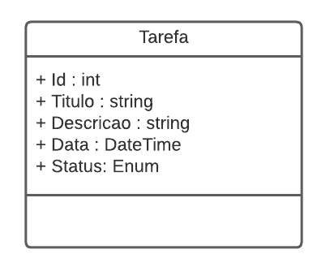
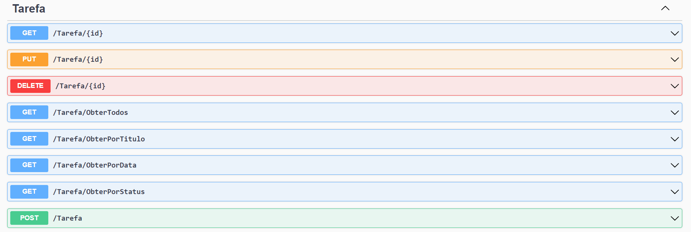

# TaskFlow

Repositório do projeto **TaskFlow**, com dois alvos em andamento:

- **TaskFlow.Console** — aplicação console de gerenciamento de tarefas (*To-Do List*), conforme a [lista de exercícios](lista_de_exerc_cios_git_semantic_flow_e_net.md).
- **TaskFlow.API** — Web API (ASP.NET Core) para o mesmo domínio de tarefas, com persistência em arquivo JSON.

## Pré-requisitos

- [.NET SDK 10.0](https://dotnet.microsoft.com/download) ou superior (`dotnet --version`)

## Estrutura da solução

| Projeto | Descrição |
|---|---|
| `TaskFlow.Console/` | Aplicação console com menu interativo e persistência em JSON |
| `TaskFlow.Tests/` | Testes unitários com xUnit para o `TaskManager` e o storage JSON |
| `TaskFlow.API/` | Web API com controllers e persistência em JSON |

## Compilar

```bash
dotnet build TaskFlow.slnx
```

## Executar os testes

```bash
dotnet test TaskFlow.slnx
```

A suíte cobre as regras de validação do `TaskManager` (adição com título válido, rejeição de títulos vazios e busca por Id inexistente) e o round-trip de persistência do storage JSON.

## Rodar a aplicação console

```bash
dotnet run --project TaskFlow.Console
```

O menu interativo permite adicionar tarefas, listar as tarefas cadastradas, concluir uma tarefa pelo Id e sair do programa. As tarefas são salvas em `tarefas.json` e recarregadas na próxima execução.

## Rodar a API

```bash
dotnet run --project TaskFlow.API
```

Com o ambiente de desenvolvimento ativo, o Swagger fica disponível em `https://localhost:<porta>/swagger`.

---

# TaskFlow.API — Web API de Tarefas

Desafio de projeto do módulo de **API** (trilha .NET, [DIO](https://www.dio.me)): um sistema gerenciador de tarefas com CRUD completo.

## Contexto

A aplicação deverá permitir cadastrar, consultar, atualizar e deletar tarefas. A classe principal é `Tarefa`:



As tarefas são persistidas em um arquivo JSON (`tarefas.json`), configurado pela chave `TaskFlow:DataFile` em `TaskFlow.API/appsettings.Development.json`.

## Métodos esperados

**Swagger**



**Endpoints**

| Verbo  | Endpoint                | Parâmetro | Body          |
|--------|-------------------------|-----------|---------------|
| GET    | /Tarefa/{id}            | id        | N/A           |
| PUT    | /Tarefa/{id}            | id        | Schema Tarefa |
| DELETE | /Tarefa/{id}            | id        | N/A           |
| GET    | /Tarefa/ObterTodos      | N/A       | N/A           |
| GET    | /Tarefa/ObterPorTitulo  | titulo    | N/A           |
| GET    | /Tarefa/ObterPorData    | data      | N/A           |
| GET    | /Tarefa/ObterPorStatus  | status    | N/A           |
| POST   | /Tarefa                 | N/A       | Schema Tarefa |

Schema (model) de `Tarefa` utilizado nos métodos que exigirem body:

```json
{
  "id": 0,
  "titulo": "string",
  "descricao": "string",
  "data": "2022-06-08T01:31:07.056Z",
  "status": "Pendente"
}
```

## Persistência

A API não depende de banco de dados: as tarefas são gravadas em um arquivo JSON. O caminho do arquivo é definido pela chave `TaskFlow:DataFile` em `TaskFlow.API/appsettings.Development.json` (padrão: `tarefas.json`):

```json
{
  "TaskFlow": {
    "DataFile": "tarefas.json"
  }
}
```

O arquivo é criado automaticamente na primeira escrita e não é versionado (está no `.gitignore`).
